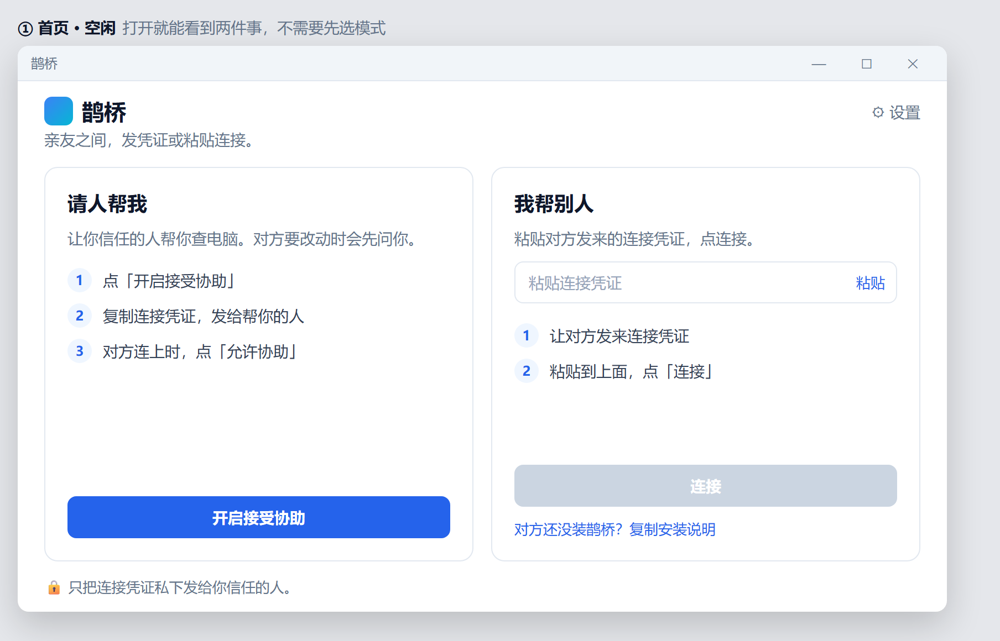
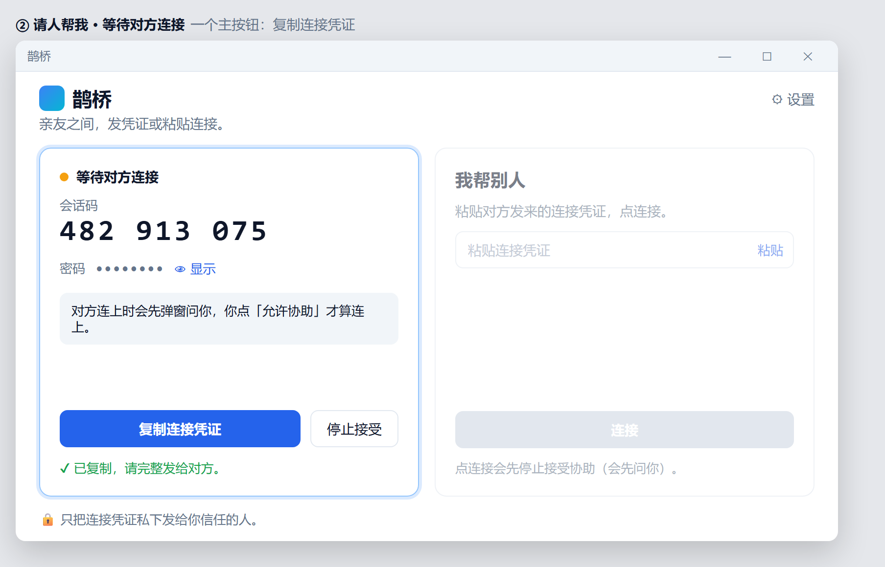
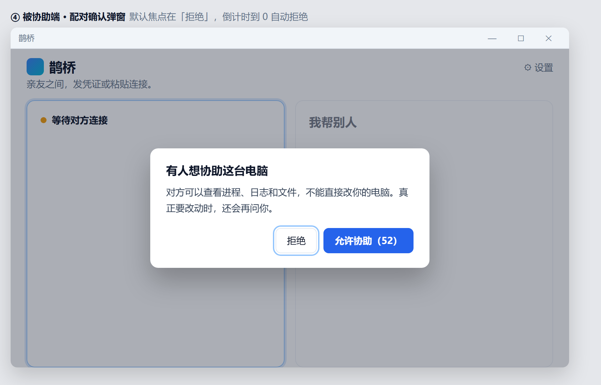
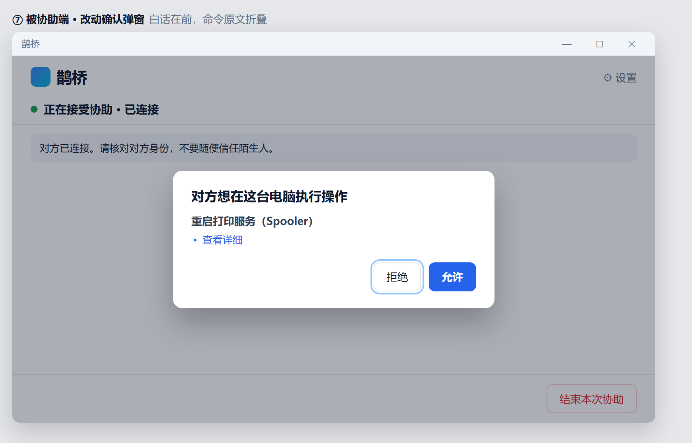
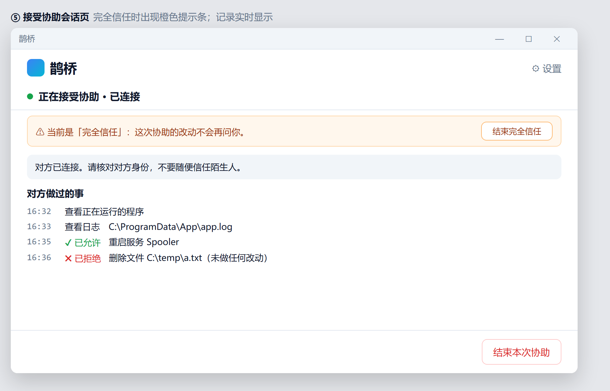
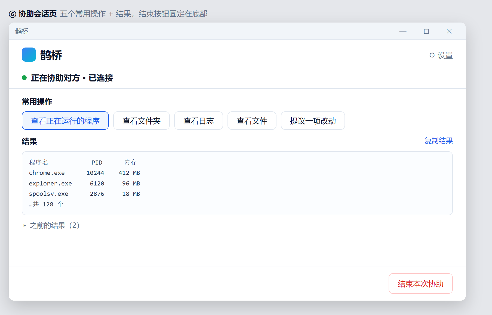
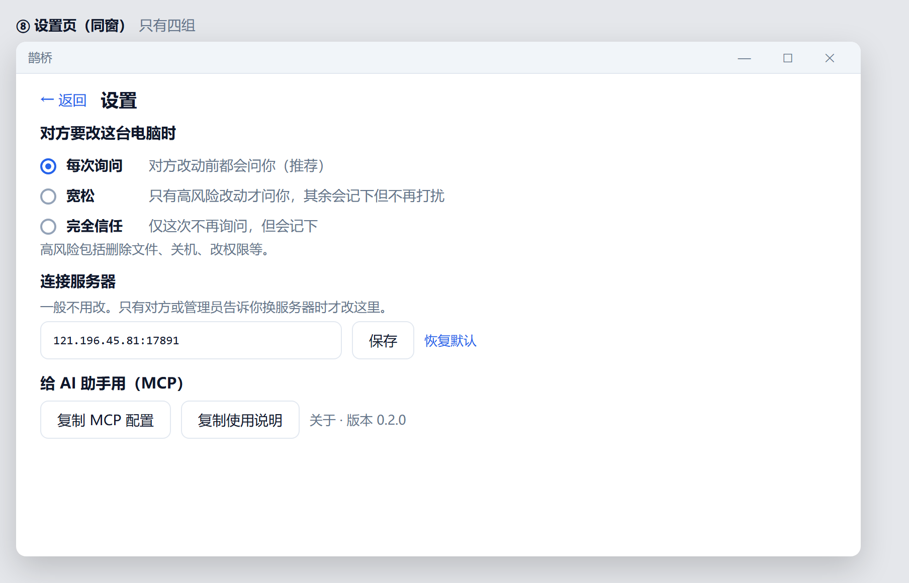
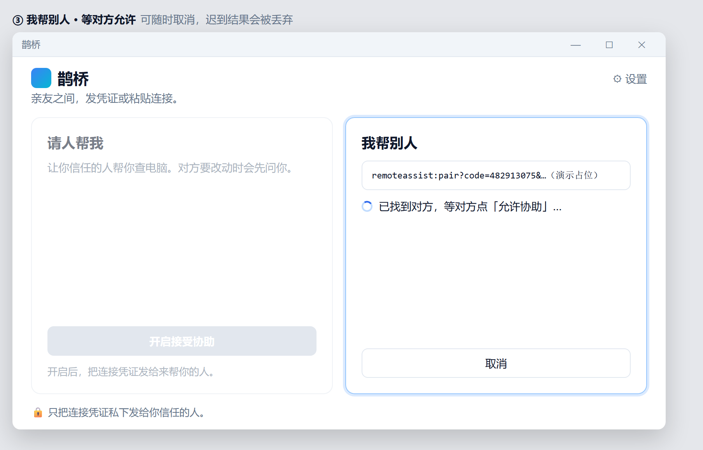

@[TOC](目录)

> 一句话：鹊桥把两边连上——对方装好客户端、发来连接凭证，你就能查进程/日志/文件；真正要改电脑时，必须在对方眼前点「允许」。

- 官网：http://121.196.45.81/
- Windows 下载：http://121.196.45.81/downloads/Queqiao-Setup-0.1.0.exe（文件名以官网为准）
- 开源仓库：https://github.com/guoshuaipeng/remote-assist（Gitee：https://gitee.com/CodeYG/remote-assist）
- 需要人帮你修电脑？可留联系方式：http://121.196.45.81/ask

---

## 一、适合谁

- **家里的「技术担当」**：父母电脑又弹广告、打印机罢工、浏览器被绑架——你不想装 TeamViewer 全家桶，也不想让对方面对黑乎乎的远程桌面。
- **帮同事快速排障**：查一下进程吃内存、翻一眼日志、确认某个文件在不在；改配置前对方本机点一下允许，双方都安心。
- **轻量客户支持**：发安装包 → 对方复制连接凭证 → 你粘贴连接；危险操作走确认窗，拒绝则「未做任何改动」。
- **讨厌被「画面接管」的人**：鹊桥主路径是命令协助，不是完整远程桌面 / 键鼠注入。

---

## 二、三个真实使用场景

### 场景 A：周末帮爸妈修电脑

爸妈说「网页打不开了」。你让他们打开鹊桥，点「开启接受协助」，再点「复制连接凭证」发给你。

你在自己电脑粘贴凭证、点连接。对方屏幕上会先弹出配对确认——超时会自动拒绝，默认焦点也不偏向「允许」。

连上后，你先看正在运行的程序、日志或文件夹；要重启打印服务之类，对方会看到白话确认窗。点「拒绝」= 什么都没改。

他们全程看得见：谁连上来了、提议改了什么、哪些允许了、哪些拒绝了。

### 场景 B：同事机器「打印不了 / 服务挂了」

你在协助端一屏完成常用操作：查看进程、文件夹、日志、文件，再「提议一项改动」。

对方本机默认是「每次询问」。如果操作很多、又彼此信任，对方可以在本机把信任档改成「宽松」（高风险仍问）或「完全信任」（仅本次会话不再问，仍记审计）。你**不能**远程替对方打开完全信任。

### 场景 C：客户说「装个软件帮我看看」

流程很短：

1. 把官网下载地址或安装说明发给客户（协助端可复制安装说明）。
2. 客户安装后「开启接受协助」，把连接凭证私下发给你。
3. 你连接 → 排查 → 改动走本机确认 → 结束协助。

连接过程也会有明确状态，而不是卡住无反馈。

---

## 三、核心能力（对照界面）

### 1. 一打开两件事：请人帮我 / 我帮别人

首页左右两区并列，不用先选「模式」再跳页。亲友话术，不堆 TLS、端口、指纹术语。

### 2. 连接凭证，而不是教对方填 IP

被协助端展示会话码与密码；主操作是「复制连接凭证」。协助端一个输入框粘贴后连接。中继地址默认内置，一般人不用进高级设置。

### 3. 先看后改，改之前再问一次

协助方默认可以查看进程、日志、文件；真正改动走本机确认。配对成功 ≠ 授权随便改。

### 4. 审计看得见

被协助端有「对方做过的事」：看过什么、允许了什么、拒绝了什么（拒绝时明确「未做任何改动」）。

### 5. 信任等级由本机主人决定

- **每次询问**（推荐默认）：改动前都问
- **宽松**：高风险（删文件、关机、改权限等）仍问，其余记审计
- **完全信任**：仅当前会话；结束后不沿用到下一个访客

---

## 四、安全设计（推荐给在意隐私的人）

| 原则 | 说明 |
|------|------|
| 写操作本机确认 | 协助方不能绕过；中继不代执行 |
| 配对可拒绝 / 超时拒绝 | 人不在电脑前时，不会默默连上 |
| 凭证私下发 | 界面明确提醒：只发给你信任的人 |
| 不做画面接管主路径 | 当前定位是命令协助，不是完整远程桌面 |
| 完全信任可随时结束 | 且不跨会话自动继承 |

不确定的能力、未上线的路线图，本文不写。下载与安装包以官网 / Release 页面为准。

---

## 五、下载安装（Windows）

1. 打开官网：http://121.196.45.81/
2. 下载 Windows 安装包（当前示例名：`Queqiao-Setup-0.1.0.exe`，以页面实际文件为准）
3. 安装后打开「鹊桥」
4. 被协助：点「开启接受协助」→「复制连接凭证」发给对方  
   协助方：粘贴凭证 →「连接」
5. 改动出现时，在**被协助那台电脑**上点允许或拒绝

其他系统安装包是否开放，请直接看官网下载区，勿以本文截图为准。

---

## 六、最后

如果你也经常被叫去「远程看一眼电脑」，又不想每次都上完整远程桌面，欢迎试一下鹊桥。

- 官网与下载：http://121.196.45.81/
- 开源：https://github.com/guoshuaipeng/remote-assist
- 问题与建议：欢迎在 GitHub / Gitee 提 Issue
