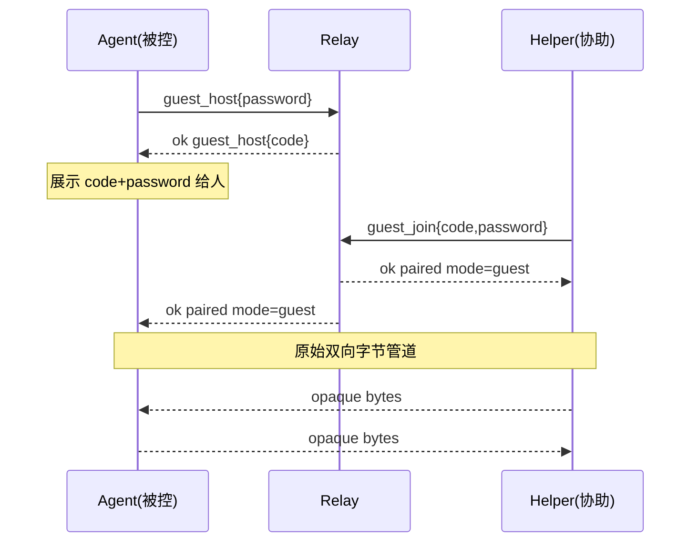
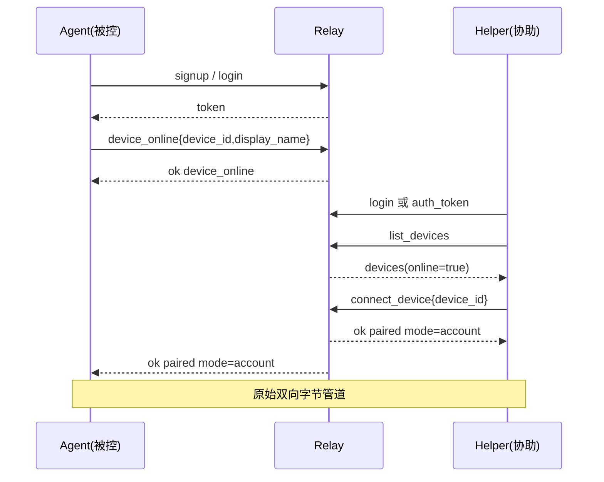

# 中继控制协议（.NET 客户端对接契约）

> 实现方：Go `relay/`。消费方：.NET Helper / Agent / 统一 App。  
> 传输：**单 TCP 端口**（默认 `RELAY_ADDR=:17891`）。纯 IP 可连。

## 总览

1. 客户端 TCP 连接到中继。
2. **控制阶段**：双方交换 **JSON Lines**（每个对象一行，UTF-8，以 `\n` 结束）。
3. 配对成功后，中继向两端各发一行 `{"ok":true,"op":"paired",...}`，随后连接切换为 **原始双向字节管道**（opaque）。业务 `FrameIo`/TLS 可骑在管道内；中继不再解析。
4. 密码字段**不得**写入日志。

### 通用约定

| 项 | 约定 |
|---|---|
| 请求 | `{"op":"<name>", ...}` |
| 成功 | `{"ok":true, "op":"<name或paired>", ...}` |
| 失败 | `{"ok":false, "op":"<name>", "error":"<机器可读英文短句>"}` |
| 同一连接 | 可连续发多个控制 op（例如 `login` → `list_devices` → `connect_device`） |
| 进入 pipe 后 | 不得再发控制 JSON；断开即结束会话 |
| 限制 | 最大并发管道 64；等待/空闲超时默认 10 分钟；访客密码最少 4 字符；账号密码最少 4 字符 |

---

## Ops

### 1. `signup`

```json
{"op":"signup","username":"alice","password":"secret1"}
→ {"ok":true,"op":"signup","user_id":1}
```

错误例：`username taken` / `password too short (min 4)` / `invalid username`

### 2. `login`

```json
{"op":"login","username":"alice","password":"secret1"}
→ {"ok":true,"op":"login","token":"<hex>","user_id":1}
```

- `token`：不透明随机串，约 7 天有效；存库。
- 成功后**本连接**已绑定账号（无需再 `auth_token`，除非新连接）。

错误：`invalid credentials`

### 3. `auth_token`

```json
{"op":"auth_token","token":"<hex>"}
→ {"ok":true,"op":"auth_token","user_id":1}
```

用于新 TCP 连接恢复登录态。错误：`invalid token` / `token expired` / `missing token`

### 4. `device_online`（需账号）

被控端（agent）在中继上登记设备并**保持连接等待**协助端。

```json
{"op":"device_online","device_id":"<client-stable-uuid>","display_name":"客厅 PC"}
→ {"ok":true,"op":"device_online","device_id":"..."}
```

之后等待；当同账号 `connect_device` 成功时，本端再收到：

```json
{"ok":true,"op":"paired","mode":"account","device_id":"..."}
```

然后进入原始管道。

错误：`unauthorized` / `invalid device_id` / `agent already online` / `too many sessions (max 64)` / 超时 `wait timeout`

### 5. `device_offline`（需账号）

```json
{"op":"device_offline","device_id":"..."}
→ {"ok":true,"op":"device_offline","device_id":"..."}
```

主动下线等待中的 agent；TCP 断开时也会清理。

### 6. `list_devices`（需账号）

```json
{"op":"list_devices"}
→ {"ok":true,"op":"list_devices","devices":[
    {"device_id":"...","display_name":"客厅 PC","online":true,"last_seen":1730790000}
  ]}
```

`online=true` 表示该设备当前有 `device_online` 等待连接。

### 7. `connect_device`（需账号，协助端）

```json
{"op":"connect_device","device_id":"..."}
→ {"ok":true,"op":"paired","mode":"account","device_id":"..."}
```

要求：设备属于同一用户且当前 online。成功后两端进入原始管道。

错误：`unauthorized` / `device not found` / `peer not online` / `helper already connected` / `too many sessions (max 64)`

### 8. `guest_host`（被控 / agent）

```json
{"op":"guest_host","password":"test","code":""}
→ {"ok":true,"op":"guest_host","code":"AB12CD","expires_at":1730797200}
```

- `code` 可空：服务端生成 **6 位**（字母数字，排除易混字符）。
- `password` 必填，最少 4 字符。
- 本连接作为 agent 等待；配对后收到 `{"ok":true,"op":"paired","mode":"guest","code":"..."}` 再进入管道。

### 9. `guest_join`（协助 / helper）

```json
{"op":"guest_join","code":"AB12CD","password":"test"}
→ {"ok":true,"op":"paired","mode":"guest","code":"AB12CD"}
```

错误：`invalid code or password` / `guest session expired` / `peer not online` 等。

---

## 序列图

### A. 访客：code + password



### B. 账号：登录 → 设备上线 → 列表 → 连接



---

## ASCII 备忘（访客）

```
Agent:  {"op":"guest_host","password":"test"}
Relay→A: {"ok":true,"op":"guest_host","code":"AB12CD","expires_at":...}
Helper: {"op":"guest_join","code":"AB12CD","password":"test"}
Relay→H: {"ok":true,"op":"paired","mode":"guest","code":"AB12CD"}
Relay→A: {"ok":true,"op":"paired","mode":"guest","code":"AB12CD"}
<raw pipe>
```

---

## 安全与产品约束（客户端必须遵守）

1. **Assist 写操作**（跑命令等）仍须在被控本机 UI/确认队列通过；中继配对成功 ≠ 授权写操作。
2. 访客 `code`+`password` 等同会话密钥，展示给用户时注意防肩窥；过期约 2 小时。
3. 账号 `token` 应安全存储（DPAPI/凭据保管库）；泄漏可免密连本账号在线设备。
4. 进入 pipe 后，建议业务层仍做会话内鉴权（现有短时令牌/配对确认可保留）。

## 环境变量

| 变量 | 默认 | 含义 |
|---|---|---|
| `RELAY_ADDR` | `:17891` | 监听地址 |
| `RELAY_DATA` | `./data/relay.db` | SQLite 路径 |
